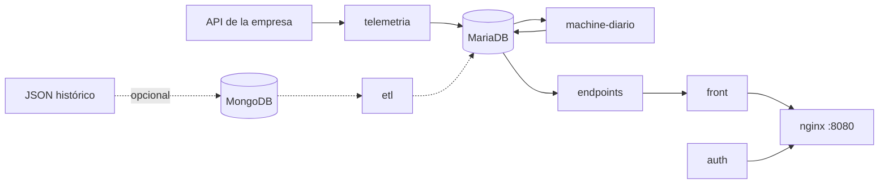

# Artisa Transportes

Monitoreo de flota con la telemetría GPS real de la empresa: reportes diarios (00:00 a
00:00 hora de Chile), clasificación de rutas por uso y mapa de camiones.

- **Instalar y operar:** [docs/INSTALACION.md](docs/INSTALACION.md)
- **Web:** http://localhost:8080 (usuario `admin`)
- **Comandos:** `python3 scripts/artisa.py --help`



## Servicios (Docker Compose)

| Servicio | Qué hace |
|---|---|
| `telemetria` | Trae los reportes de la API de la empresa cada 30 s. Sobrevive a cortes de red y recupera lo pendiente sin duplicar. |
| `machine-diario` | Cierra cada día, extrae viajes, clasifica las rutas y predice la actividad de los próximos 15 días (00:30). |
| `mariadb` | Base de datos (volumen persistente). |
| `endpoints` | API de solo lectura para la web (`/api/*`). |
| `front` + `nginx` | Interfaz web; nginx es la única entrada (puerto 8080). |
| `auth` | Inicio de sesión (contraseña con hash, sesiones JWT de 12 h). |
| `respaldo` | Respaldo diario de MariaDB en `respaldos/` (03:00). |
| `mongodb` + `etl` | Solo para cargar el JSON histórico (`ETL_HISTORICO=1`). |

## Reglas clave

- **Día:** de 00:00 a 00:00 hora de Chile. Ningún reporte queda fuera ni se cuenta dos veces.
- **Recorrido:** solo se unen reportes seguidos (5 min o menos y bajo 150 km/h). Los saltos de GPS no se dibujan.
- **Parada:** 10 min dentro de 200 m. Una espera larga (por ejemplo, cargando) es una parada, no corta el viaje.
- **Viaje:** recorrido entre dos paradas. Los viajes partidos por la medianoche se empalman.
- **Ruta:** viajes con el mismo origen y destino (faena o lugar frecuente) y la misma trayectoria (750 m). Ida y vuelta son la misma ruta. Mínimo 5 viajes y 2 camiones.
- **Nivel de uso:** verde = más usada (sobre el percentil 67), naranja = uso medio, rojo = poco usada (percentil 33 o menos). Ventana: últimos 90 días.
- **Línea de la ruta:** un viaje real observado (el más representativo), nunca un promedio inventado.
- **Predicción (LightGBM), un solo módulo con dos modelos:** *mapa de calor* (reportes en movimiento por zona de ~1 km) y *rutas* (camiones distintos por tramo de ~1 km). Aprende de las últimas 16 semanas (mínimo 21 días). En días de prueba compiten LightGBM, el promedio del mismo día de la semana y el promedio histórico; se publica el que se equivoque menos. Se reentrena desde cero cada vez que se cierra un día y se recalcula cada medianoche: pronostica de mañana a hoy + 15 (los días que ya pasaron nunca se muestran) y publica solo los días cuyo error no supera en más de 30 % al del primer día (mínimo 7). Al reentrenar mide el **error real**: lo que la versión anterior predijo para el día recién cerrado contra lo que pasó. En la web, la predicción de rutas se muestra por **ruta completa** (las de la clasificación, con su viaje real representativo): cada ruta lleva un solo valor, la mediana de los camiones predichos en sus tramos, y un solo color (verde, naranja o rojo con los mismos percentiles que la clasificación).
- **Camiones nuevos:** cuando el catálogo de camiones cambia, la predicción vuelve a contar las 16 semanas con la lista nueva y se reentrena.
- **Camiones:** solo los del catálogo `DB/vehiculos_data.sql`. La patente y el conductor vienen del GPS (no se guarda el RUT).

## Web

| Sección | Contenido |
|---|---|
| Camiones en vivo (inicio) | Estado de cada camión (en ruta, detenido, sin señal reciente) y lo que hizo hoy o cualquier día anterior. Ficha por camión y día: recorrido en el mapa con cada viaje, paradas, reproducción del día, últimos 30 días, reportes GPS del día e imagen descargable. Abajo, los últimos reportes recibidos en vivo y el resumen del mes con descarga CSV. |
| Dashboard | Rutas por nivel de uso, ranking y estado de la flota. |
| Predicción | Pestañas **Mapa de calor** y **Rutas**: hasta 15 días con ruleta de días, rango, recorrido animado, confianza por día y comparación de métodos. |
| Mapa de rutas | Estudio del histórico. **Rutas clasificadas**: rutas completas por nivel de uso (filtros y buscador), resumen del período y rutas más y menos usadas; los camiones se encienden aparte. **Mapas de telemetría**: calor, rutas por camión, uso de rutas y puntos para un rango de hasta 14 días. |
| Arquitectura | Estado de cada servicio. |

## Estructura

```
DB/                 esquema y catálogos (vehículos, faenas)
telemetria_api/     conector de la API de la empresa
machine_learning/   cierre diario, viajes, clasificación de rutas y predicción
endpoints/          API de la web
front/  auth/  nginx/
ETLs/               carga del JSON histórico (opcional)
guias_ml/           cuadernos de experimentación (Colab), sin salidas ni datos
scripts/            artisa.py (comandos), start.py, respaldo, comprobaciones
tests/              pruebas: python3 -m unittest discover -s tests
```

## Seguridad

- Las claves viven solo en `.env` (se crea solo y no se sube a Git).
- La conexión a la API de la empresa es de solo lectura (`SELECT`) y no crea índices ni modifica su base.
- Nunca usar `docker compose down -v`: borra la base de datos.

## Pendiente

- Alertas de Machine (paradas fuera de lo normal y desvíos de ruta) para que la empresa las revise.
