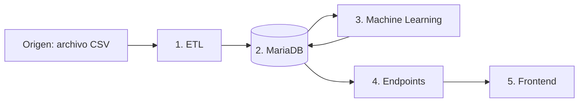

# Artisa: cinco contenedores, un proyecto

Demostración local de la arquitectura del proyecto de transporte. Todo se inicia
con Docker Compose y se abre en [http://localhost:8080](http://localhost:8080).



El origen es un archivo externo a los contenedores, montado en modo de lectura.
Los cinco servicios son `etl`, `mariadb`, `machine`, `endpoints` y `front`.
Machine Learning y endpoints tienen contenedores distintos. El modelo lee la base
y guarda allí sus resultados; la API consulta esos resultados para el frontend.

## Iniciar desde Visual Studio Code

1. Abre esta carpeta en VS Code.
2. Presiona **Ctrl + Shift + B** o usa **Terminal > Ejecutar tarea > Docker: levantar proyecto completo**.
3. Abre [http://localhost:8080](http://localhost:8080).
4. Para comprobar el recorrido ejecuta **Docker: comprobar servicio**.

La tarea genera `.env` si falta, construye las imágenes e inicia los cinco
contenedores en orden, esperando sus comprobaciones de salud.
Las tareas antiguas para levantar API y MariaDB también inician ahora el proyecto completo.

Desde **PowerShell**, en la carpeta del proyecto, basta este comando:

```powershell
wsl -d Ubuntu --exec python3 scripts/start.py
```

Desde una terminal **Ubuntu/WSL**:

```bash
python3 scripts/start.py
```

Con `.env` ya preparado también se puede ejecutar directamente:

```bash
docker compose up --detach --build --wait --wait-timeout 180
```

Docker Engine, Compose y Buildx están instalados en Ubuntu en este equipo. La
primera construcción descarga las dependencias de Machine Learning.

## Organización

```text
Capstone Artisa/
├── compose.yaml             # Orquesta los cinco contenedores
├── front/                   # Pantalla HTML/CSS/JS y proxy a endpoints
│   ├── Dockerfile
│   ├── server.py
│   └── static/
├── endpoints/               # API; consulta y registra solicitudes en MariaDB
│   ├── Dockerfile
│   └── api.py
├── modelo_machine/          # Entrena, predice y escribe los resultados
│   ├── Dockerfile
│   ├── requirements.txt
│   └── worker.py
├── DB/
│   └── schema.sql           # Tablas del flujo; imagen oficial MariaDB
├── ETLs/
│   ├── Dockerfile
│   ├── worker.py
│   └── transform.py
├── origen/
│   └── viajes.csv           # Origen sintético reemplazable
├── common/                  # Conexión, HTTP y validación compartidos
├── scripts/                 # Arranque, credenciales y comprobaciones
├── tests/                   # Validación del ETL
├── .vscode/tasks.json       # Una tarea para levantar todo
├── .env.example             # Nombres de variables, sin contraseñas
└── .env                     # Solo local; nunca subir a GitHub
```

`app.py`, `schema.sql` y el `Dockerfile` de la raíz conservan la API inicial de
mensajes como compatibilidad. Compose utiliza los Dockerfiles de las carpetas;
los nuevos endpoints heredan las rutas de mensajes de `app.py`.

## Qué hace la demostración

1. **Origen:** `origen/viajes.csv` contiene 124 filas sintéticas: 120 viajes válidos,
   un duplicado y tres filas inválidas para comprobar la limpieza. Las distancias
   y duraciones son ficticias, aunque las ciudades tienen nombres reales.
2. **ETL:** revisa el archivo cada 15 segundos. Normaliza nombres, espacios y comas
   decimales, valida rangos y rechaza duplicados. La carga se confirma en una
   transacción, con versión SHA-256, conteos y motivos de rechazo.
3. **MariaDB:** conserva viajes, estado de la carga, metadatos del modelo,
   predicciones y solicitudes en el volumen persistente `artisa_mariadb_data`.
4. **Machine Learning:** entrena una regresión lineal con distancia, carga y paradas
   para estimar duración en horas. Evalúa con una división reproducible 80/20,
   reporta el error absoluto medio (MAE) y ajusta el modelo final con todos los
   registros válidos. Guarda una predicción por viaje. Reentrena al cambiar la
   versión del origen o reiniciarse el trabajador.
5. **Endpoints y frontend:** la pantalla consulta datos, estado y predicciones a
   través de la API. El formulario registra una solicitud pendiente en MariaDB;
   Machine la procesa en su siguiente ciclo (cada 2 segundos), guarda el resultado
   y la pantalla lo consulta por ID. Los endpoints no ejecutan el modelo.

El modelo es demostrativo y no está validado para estimar operaciones reales.
El MAE mostrado corresponde a las filas reservadas para evaluación, no al ajuste
sobre todas las filas ni a viajes reales.

## Cambiar el origen

Edita `origen/viajes.csv` y guarda el archivo. No hace falta reconstruir las imágenes;
el ETL lo relee automáticamente. Conserva estas columnas:

```csv
id,origen,destino,distancia_km,carga_kg,paradas,duracion_horas
VIAJE-001,Antofagasta,Calama,220,8000,2,4.5
```

Se necesitan al menos 10 viajes válidos para entrenar el modelo. El ejemplo de una
fila ilustra el formato. Rangos: distancia 1–2000 km, carga 1–40000 kg, paradas
enteras 0–30 y duración observada 0,01–100 horas. Límite del archivo demo: 5 MB.
La duración observada es la variable que el modelo aprende a predecir.

Un CSV sin filas válidas o sin las columnas requeridas se rechaza y se conserva
la carga anterior. Repetir el mismo archivo no duplica viajes. Si se retira un ID
válido del archivo, deja de formar parte de la versión activa; su fila histórica
permanece almacenada. La API muestra solo viajes de la versión activa.

Si la próxima fuente es una API, Excel u otra base, el adaptador a reemplazar está
en `ETLs/worker.py`; se mantiene el mismo contrato de datos transformados.

## Endpoints

Todos se pueden consultar a través del frontend en `http://localhost:8080`.

| Método | Ruta | Uso |
| --- | --- | --- |
| GET | `/` | Pantalla del proyecto |
| GET | `/health` | Salud del recorrido (503 si hay una etapa sin respuesta reciente) |
| GET | `/api/estado` | Estado, versión del origen, rechazos y metadatos del modelo |
| GET | `/api/resumen` | Totales de viajes, predicciones y destinos |
| GET | `/api/viajes?limite=20` | Viajes de la carga activa con sus predicciones; máximo 500 |
| GET | `/api/modelo` | Métricas de evaluación y coeficientes |
| POST | `/api/predicciones` | Crea una solicitud; responde 202 con ID y URL de consulta |
| GET | `/api/predicciones/{id}` | Estado y resultado persistido de una solicitud |
| GET/POST | `/mensajes` | Demostración anterior de lectura y escritura |
| GET/DELETE | `/mensajes/{id}` | Consulta o elimina un mensaje concreto |

Cuerpo para solicitar una predicción:

```json
{"distancia_km":180,"carga_kg":8000,"paradas":2}
```

## Comprobar y detener

En Ubuntu/WSL, desde esta carpeta:

```bash
python3 -m unittest discover -s tests -v
python3 scripts/check.py
docker compose ps
docker compose logs --tail 30
docker compose stop
```

En PowerShell antepone `wsl -d Ubuntu --exec` a cada comando.
`check.py` comprueba el frontend, la carga ETL, el modelo y dos solicitudes reales
procesadas por Machine y almacenadas en MariaDB. También mantiene la prueba de
mensajes, que crea y elimina únicamente su propio mensaje temporal. Las dos
solicitudes de predicción quedan como registros de demostración.

`python3 scripts/check.py --persistence` opcionalmente recrea MariaDB y comprueba
que un mensaje temporal sobreviva. Produce una interrupción breve mientras arranca
la base; no es necesario para iniciar el proyecto.

Detener o reconstruir los contenedores conserva los datos. No utilices
`docker compose down --volumes` salvo que quieras eliminar la base.

## Configuración local

Solo el frontend publica un puerto: `127.0.0.1:8080`. MariaDB, ETL, Machine y endpoints
se comunican por la red interna de Compose. La página es una demo local sin
usuarios ni autenticación; no se publica en Internet.

`scripts/prepare_env.py` crea contraseñas aleatorias una sola vez y conserva `.env`
si ya existe. No cambies estas contraseñas mientras uses el volumen actual sin
actualizar también las cuentas de MariaDB. `.env` no entra en Git ni en las imágenes.
La tabla de mensajes y el volumen de la prueba anterior se conservan.

## Referencias

- [Docker Compose: dependencias y comprobaciones de salud](https://docs.docker.com/compose/how-tos/startup-order/)
- [scikit-learn: regresión lineal](https://scikit-learn.org/stable/modules/generated/sklearn.linear_model.LinearRegression.html)
- [scikit-learn 1.7.2](https://pypi.org/project/scikit-learn/1.7.2/)
