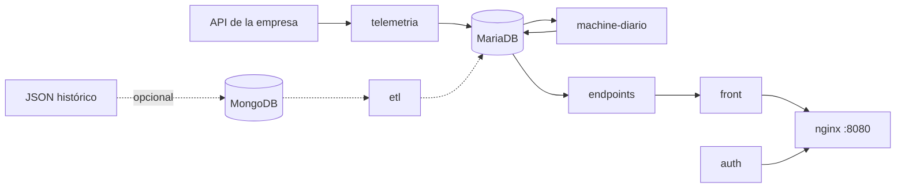

# Artisa Transportes

Monitoreo de flota con la telemetría GPS real de la empresa: reportes diarios (00:00 a
00:00 hora de Chile), clasificación de rutas por uso y mapa de camiones.

- **Instalar y operar:** [docs/INSTALACION.md](docs/INSTALACION.md)
- **Web:** http://localhost:8080 (usuario `admin`)
- **Comandos:** `python3 scripts/artisa.py --help`



## Servicios (Docker Compose)

| Servicio | Qué hace |
|---|---|
| `telemetria` | Trae los reportes de la API de la empresa cada 30 s. Sobrevive a cortes de red y recupera lo pendiente sin duplicar. |
| `machine-diario` | Cierra cada día, extrae viajes y clasifica las rutas (00:30). |
| `mariadb` | Base de datos (volumen persistente). |
| `endpoints` | API de solo lectura para la web (`/api/*`). |
| `front` + `nginx` | Interfaz web; nginx es la única entrada (puerto 8080). |
| `auth` | Inicio de sesión (contraseña con hash, sesiones JWT de 12 h). |
| `respaldo` | Respaldo diario de MariaDB en `respaldos/` (03:00). |
| `mongodb` + `etl` | Solo para cargar el JSON histórico (`ETL_HISTORICO=1`). |

## Reglas clave

- **Día:** de 00:00 a 00:00 hora de Chile. Ningún reporte queda fuera ni se cuenta dos veces.
- **Recorrido:** solo se unen reportes seguidos (5 min o menos y bajo 150 km/h). Los saltos de GPS no se dibujan.
- **Parada:** 10 min dentro de 200 m. Una espera larga (por ejemplo, cargando) es una parada, no corta el viaje.
- **Viaje:** recorrido entre dos paradas. Los viajes partidos por la medianoche se empalman.
- **Ruta:** viajes con el mismo origen y destino (faena o lugar frecuente) y la misma trayectoria (750 m). Ida y vuelta son la misma ruta. Mínimo 5 viajes y 2 camiones.
- **Nivel de uso:** verde = más usada (sobre el percentil 67), naranja = uso medio, rojo = poco usada (percentil 33 o menos). Ventana: últimos 90 días.
- **Línea de la ruta:** un viaje real observado (el más representativo), nunca un promedio inventado.
- **Camiones:** solo los del catálogo `DB/vehiculos_data.sql`. La patente y el conductor vienen del GPS (no se guarda el RUT).

## Web

| Sección | Contenido |
|---|---|
| Arquitectura | Estado de cada servicio. |
| Reportes | Últimos 30 reportes en vivo e historial por día y por mes. |
| Dashboard | Rutas por nivel de uso, ranking y estado de la flota. |
| Mapa de rutas | **Rutas clasificadas** (filtros, camiones, recorrido del día, faenas, satélite y densidad GPS) y **Mapas de telemetría** (calor, rutas por camión, uso de rutas y puntos para un rango de hasta 14 días). |

## Estructura

```
DB/                 esquema y catálogos (vehículos, faenas)
telemetria_api/     conector de la API de la empresa
machine_learning/   cierre diario, viajes y clasificación de rutas
endpoints/          API de la web
front/  auth/  nginx/
ETLs/               carga del JSON histórico (opcional)
scripts/            artisa.py (comandos), start.py, respaldo, comprobaciones
tests/              pruebas: python3 -m unittest discover -s tests
```

## Seguridad

- Las claves viven solo en `.env` (se crea solo y no se sube a Git).
- La conexión a la API de la empresa es de solo lectura (`SELECT`) y no crea índices ni modifica su base.
- Nunca usar `docker compose down -v`: borra la base de datos.

## Pendiente

- Alertas de Machine (paradas fuera de lo normal y desvíos de ruta) para que la empresa las revise.
