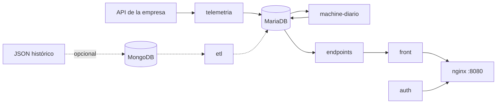

# Artisa Transportes

Monitoreo de flota con la telemetría GPS real de la empresa: reportes diarios (00:00 a
00:00 hora de Chile), clasificación de rutas por uso y mapa de camiones.

- **Instalar y operar:** [docs/INSTALACION.md](docs/INSTALACION.md)
- **Web:** http://localhost:8080 (usuario `admin`)
- **Comandos:** `python3 scripts/artisa.py --help`



## Servicios (Docker Compose)

| Servicio | Qué hace |
|---|---|
| `telemetria` | Trae los reportes de la API de la empresa cada 30 s. Sobrevive a cortes de red y recupera lo pendiente sin duplicar. |
| `machine-diario` | Cierra cada día, extrae viajes, clasifica las rutas y predice la actividad de los próximos 15 días (00:30). |
| `mariadb` | Base de datos (volumen persistente). |
| `endpoints` | API de solo lectura para la web (`/api/*`). |
| `front` + `nginx` | Interfaz web; nginx es la única entrada (puerto 8080). |
| `auth` | Inicio de sesión (contraseña con hash, sesiones JWT de 12 h). |
| `respaldo` | Respaldo diario de MariaDB en `respaldos/` (03:00). |
| `mongodb` + `etl` | Solo para cargar el JSON histórico (`ETL_HISTORICO=1`). |

## Reglas clave

- **Día:** de 00:00 a 00:00 hora de Chile. Ningún reporte queda fuera ni se cuenta dos veces.
- **Recorrido:** solo se unen reportes seguidos (5 min o menos y bajo 150 km/h). Los saltos de GPS no se dibujan.
- **Parada:** 10 min dentro de 200 m. Una espera larga (por ejemplo, cargando) es una parada, no corta el viaje.
- **Viaje:** recorrido entre dos paradas. Los viajes partidos por la medianoche se empalman.
- **Machine learning (un solo archivo, `machine_learning/modelo_rutas.py`, dividido en partes):** el modelo aprende las rutas de la flota sin que nadie las dibuje (aprendizaje no supervisado).
  1. **Viajes:** paradas y recorridos de cada camión (lo usa el cierre diario).
  2. **Datos:** viajes de los últimos 90 días cerrados con origen y destino conocidos (`RUTAS_VENTANA_DIAS`).
  3. **Lugares — DBSCAN:** las paradas dentro de una faena son esa faena; las demás se agrupan si hay 3 o más a menos de 500 m.
  4. **Rutas — clustering jerárquico aglomerativo:** por par de lugares (ida y vuelta juntas), los viajes que siguen el mismo camino (a menos de 750 m en promedio) son una ruta. Su línea es el **medoide**: un viaje real, nunca un promedio inventado.
  5. **Niveles — cortes naturales de Jenks:** según los camiones distintos que usaron cada ruta. **N5 mínima** = 1 o 2 camiones (`RUTAS_MAX_CAMIONES_MINIMA`); el resto se reparte en hasta 4 grupos que aprende el modelo: **N1 troncal**, **N2 muy usada**, **N3 uso medio**, **N4 poco usada**.
  6. **Entrenamiento:** se reaprende desde cero con cada 7 días cerrados nuevos (`RUTAS_CADA_DIAS`) o si cambia el método; cada versión se guarda con sus cortes y métricas.
  7. **Validación:** `python3 scripts/artisa.py rutas` reentrena y muestra la tabla de clasificación con los datos reales.
- **En vivo:** cada camión toma el nivel de la ruta aprendida que pasa a menos de ~1 km; si ninguna pasa cerca está **fuera de ruta (N6)**. **Alerta** cuando un camión en movimiento, fuera de las faenas, anda en N5 o N6 por 10 min o más y a 2 km o más de una ruta N1–N4 (`VIGILANCIA_MIN_MINUTOS`, `VIGILANCIA_MIN_KM`, `VIGILANCIA_REPORTES`).
- **Camiones:** solo los del catálogo `DB/vehiculos_data.sql`. La patente y el conductor vienen del GPS (no se guarda el RUT).

## Web

| Sección | Contenido |
|---|---|
| Camiones en vivo (inicio) | Estado de cada camión (en ruta, detenido, sin señal reciente) y lo que hizo hoy o cualquier día anterior. Ficha por camión y día: recorrido en el mapa con cada viaje, paradas, reproducción del día, últimos 30 días, reportes GPS del día e imagen descargable. La segunda vista muestra los últimos reportes recibidos en vivo. |
| Dashboard | Dos pestañas. **Centro de control**: estado actual de la flota (en ruta, detenidos, sin señal, km y viajes de hoy), actividad diaria del mes, totales del mes, comparación por camión (paradas, tiempo detenido, km, viajes), km frente a horas detenidas y hallazgos del mes. **Informes históricos**: resumen mensual por día y comparación por camión; descarga del informe operativo completo o de la matriz de reportes/km por patente, búsqueda, orden, calendarios y calidad de los datos (`/api/dashboard`, cierre diario). La comparación por camión incluye el **nivel de reporte** A–D del período: cuartiles de los reportes GPS de cada camión frente al resto de la flota (A el 25 % que más reporta, D el 25 % que menos; es relativo), filtro por nivel y aviso de los días con falla de datos, en que la flota envió menos de la mitad de la mediana diaria (`/api/dashboard/niveles?desde=&hasta=`, metodología del cuaderno `procesamientodatos.ipynb`). |
| Predicción | **Rutas aprendidas en vivo** (`/api/rutas-aprendidas` cambia con cada versión del modelo; `/api/vigilancia` cada minuto): las rutas del modelo con color y grosor según su nivel N1–N5, los camiones en vivo encima con su nivel, y las alertas (activas, sin señal, en la semana) con patente, conductor, ubicación, duración, ruta mínima y distancia a la ruta habitual más cercana. Incluye la **ficha del modelo** (algoritmos, datos, reentrenamiento) y la **tabla de clasificación** (rango de camiones de cada nivel, rutas, recorridos y camiones en cada nivel ahora). |
| Datos históricos | **Mapas de telemetría**: estudio de cualquier rango guardado de hasta 14 días (calor, rutas por camión, uso de rutas en % de la flota y puntos). Solo historial. |
| Arquitectura | Estado de cada servicio. |

## Estructura

```
DB/                 esquema y catálogos (vehículos, faenas)
telemetria_api/     conector de la API de la empresa
machine_learning/   cierre diario (diario.py, diario_worker.py) y el modelo de rutas (modelo_rutas.py)
endpoints/          API de la web
front/  auth/  nginx/
ETLs/               carga del JSON histórico (opcional)
guias_ml/           cuadernos de experimentación (Colab), sin salidas ni datos
scripts/            artisa.py (comandos), start.py, respaldo, comprobaciones
tests/              pruebas: python3 -m unittest discover -s tests
```

## Seguridad

- Las claves viven solo en `.env` (se crea solo y no se sube a Git).
- La conexión a la API de la empresa es de solo lectura (`SELECT`) y no crea índices ni modifica su base.
- Nunca usar `docker compose down -v`: borra la base de datos.

## Pendiente

- Alertas de Machine (paradas fuera de lo normal y desvíos de ruta) para que la empresa las revise.
