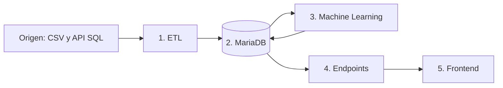

# Artisa: cinco contenedores, un proyecto

Demostración local de la arquitectura del proyecto de transporte. Todo se inicia
con Docker Compose y se abre en [http://localhost:8080](http://localhost:8080).



El proyecto conserva el CSV de demostración y añade un primer ETL real que consume
la API SQL de telemetría por lotes.
Los cinco servicios son `etl`, `mariadb`, `machine`, `endpoints` y `front`.
Machine Learning y endpoints tienen contenedores distintos. El modelo lee la base
y guarda allí sus resultados; la API consulta esos resultados para el frontend.

## Iniciar desde Visual Studio Code

1. Abre esta carpeta en VS Code.
2. Presiona **Ctrl + Shift + B** o usa **Terminal > Ejecutar tarea > Docker: levantar proyecto completo**.
3. Abre [http://localhost:8080](http://localhost:8080).
4. Para comprobar el recorrido ejecuta **Docker: comprobar servicio**.

La tarea genera `.env` si falta, construye las imágenes e inicia los cinco
contenedores en orden, esperando sus comprobaciones de salud.
Las tareas antiguas para levantar API y MariaDB también inician ahora el proyecto completo.

Desde **PowerShell**, en la carpeta del proyecto, basta este comando:

```powershell
wsl -d Ubuntu --exec python3 scripts/start.py
```

Desde una terminal **Ubuntu/WSL**:

```bash
python3 scripts/start.py
```

Con `.env` ya preparado también se puede ejecutar directamente:

```bash
docker compose up --detach --build --wait --wait-timeout 180
```

Docker Engine, Compose y Buildx están instalados en Ubuntu en este equipo. La
primera construcción descarga las dependencias de Machine Learning.

## Organización

```text
Capstone Artisa/
├── compose.yaml             # Orquesta los cinco contenedores
├── front/                   # Pantalla HTML/CSS/JS y proxy a endpoints
│   ├── Dockerfile
│   ├── server.py
│   └── static/
├── endpoints/               # API; consulta y registra solicitudes en MariaDB
│   ├── Dockerfile
│   └── api.py
├── modelo_machine/          # Entrena, predice y escribe los resultados
│   ├── Dockerfile
│   ├── requirements.txt
│   ├── telemetry.py         # Clustering DBSCAN de posiciones reales
│   └── worker.py
├── DB/
│   └── schema.sql           # Tablas del flujo; imagen oficial MariaDB
├── ETLs/
│   ├── Dockerfile
│   ├── telemetry.py         # API SQL -> validación -> MariaDB
│   ├── worker.py
│   └── transform.py
├── origen/
│   └── viajes.csv           # Origen sintético reemplazable
├── common/                  # Conexión, HTTP y validación compartidos
├── scripts/                 # Arranque, credenciales y comprobaciones
├── tests/                   # Validación del ETL
├── .vscode/tasks.json       # Una tarea para levantar todo
├── .env.example             # Nombres de variables, sin contraseñas
└── .env                     # Solo local; nunca subir a GitHub
```

`app.py`, `schema.sql` y el `Dockerfile` de la raíz conservan la API inicial de
mensajes como compatibilidad. Compose utiliza los Dockerfiles de las carpetas;
los nuevos endpoints heredan las rutas de mensajes de `app.py`.

## Qué hace la demostración

1. **Origen:** `origen/viajes.csv` contiene 124 filas sintéticas: 120 viajes válidos,
   un duplicado y tres filas inválidas para comprobar la limpieza. Las distancias
   y duraciones son ficticias, aunque las ciudades tienen nombres reales.
2. **ETL:** revisa el archivo cada 15 segundos. Normaliza nombres, espacios y comas
   decimales, valida rangos y rechaza duplicados. La carga se confirma en una
   transacción, con versión SHA-256, conteos y motivos de rechazo.
3. **MariaDB:** conserva viajes, estado de la carga, metadatos del modelo,
   predicciones y solicitudes en el volumen persistente `artisa_mariadb_data`.
4. **Machine Learning:** entrena una regresión lineal con distancia, carga y paradas
   para estimar duración en horas. Evalúa con una división reproducible 80/20,
   reporta el error absoluto medio (MAE) y ajusta el modelo final con todos los
   registros válidos. Guarda una predicción por viaje. Reentrena al cambiar la
   versión del origen o reiniciarse el trabajador.
5. **Endpoints y frontend:** la pantalla consulta datos, estado y predicciones a
   través de la API. El formulario registra una solicitud pendiente en MariaDB;
   Machine la procesa en su siguiente ciclo (cada 2 segundos), guarda el resultado
   y la pantalla lo consulta por ID. Los endpoints no ejecutan el modelo.

El modelo es demostrativo y no está validado para estimar operaciones reales.
El MAE mostrado corresponde a las filas reservadas para evaluación, no al ajuste
sobre todas las filas ni a viajes reales.

## Primer ETL de telemetría real

El mismo contenedor `etl` consulta la API SQL mediante `POST`, lee la lista `rows`,
normaliza las fechas a UTC, valida identificadores y coordenadas y guarda los datos
en `telemetria_raw`. `report_id` es la clave primaria, por lo que repetir una página
actualiza sus datos y no crea duplicados.

La extracción usa paginación por `(report_date, report_id)`, sin `OFFSET`. El cursor
y los conteos se guardan en `telemetria_etl_estado`, dentro de la misma transacción
que la página procesada. La configuración inicial limita la prueba a 5.000 filas de
un solo día para no solicitar accidentalmente los 28,8 millones de registros.

## Simulación de salida procesada y mapa operativo

La telemetría completa permanece en `telemetria_raw`; la vista del mapa no elimina,
reemplaza ni modifica esos reportes. Para evitar recalcular todo el histórico en cada
petición, `common/map_provider.py` lee una ventana de los últimos registros mediante
el índice temporal, conserva además la última posición disponible de todos los
vehículos y mantiene el resultado en caché durante cinco minutos.

`common/telemetry_map.py` ordena cada secuencia por `asset_id`, fecha y `report_id`.
Separa recorridos por pausas, detenciones prolongadas o saltos físicamente
incompatibles, y nunca une puntos de vehículos diferentes. Cada recorrido se registra
primero como `trip`, con su vehículo, inicio, término, distancia y geometría GPS.
Después se compara con el registro de rutas usando origen y destino cercanos, el mismo
sentido, al menos 60 % de geometría compartida y una tolerancia de corredor de 2 km.
La tolerancia de los extremos es proporcional al recorrido y queda limitada entre
2 y 8 km. Coordenadas exactas o la cantidad de lecturas no crean el `route_id`; el
identificador se asigna después de agrupar. De ese registro salen `route_id`,
`usage_count` y `unique_vehicle_count`, sin limitar artificialmente el número de rutas.

El contrato de `GET /api/mapa` mantiene separados:

- `routes`: geometría y clasificación global de cada ruta.
- `trips`: recorridos observados, con distancia y geometría, que justifican `usage_count`.
- `vehicles`: última latitud y longitud disponible de toda la flota.
- `stops`: zonas de detención derivadas de eventos reales.
- `readings`: celdas técnicas de actividad GPS, ocultas por defecto.

`usage_count` siempre equivale a la cantidad de `trips` asociados a la ruta. Las
lecturas, la densidad y las paradas no participan en HIGH, MEDIUM o LOW. Cada ruta
mantiene un solo color completo: HIGH verde oscuro, MEDIUM naranja y LOW rojo.

La geometría actual sigue la secuencia GPS real filtrada y se identifica como
`GPS_TRACE_FILTERED`. No se envían coordenadas privadas a servicios externos ni se
presenta esta aproximación como map matching. El ajuste exacto a la red vial se hará
posteriormente On-Premise con OSRM, Valhalla, GraphHopper u otro motor; el contrato y
el frontend no necesitarán cambiar.

El panel inspirado en una consola de monitoreo permite seleccionar una ruta o un
vehículo. Una ruta usa `fitBounds` sobre su propia geometría; un vehículo centra el
mapa en su latitud y longitud, abre su detalle y conserva su marcador. Los filtros
Todas, Más usadas, Uso medio y Poco usadas cambian únicamente la visibilidad de las
capas. Rutas, vehículos y paradas están activas al abrir; las lecturas quedan
apagadas. El archivo `simulacion/mapa_procesado.json` permanece como alternativa
para ejecutar la interfaz sin MariaDB usando `MAP_DATA_SOURCE=simulation`.

Configura estas variables únicamente en `.env`:

```dotenv
TELEMETRY_ENABLED=1
SOURCE_API_URL=http://HOST_ORIGEN:3003/sql
SOURCE_API_TIMEOUT_SECONDS=90
TELEMETRY_START=2026-03-31T00:00:00
TELEMETRY_END=2026-04-01T00:00:00
TELEMETRY_BATCH_SIZE=500
TELEMETRY_MAX_TOTAL_ROWS=5000
TELEMETRY_INTERVAL_SECONDS=300
TELEMETRY_CATCHUP_INTERVAL_SECONDS=5
TELEMETRY_RETRY_INTERVAL_SECONDS=60
TELEMETRY_CONTINUOUS=0
TELEMETRY_PAGES_PER_CYCLE=1
MAP_DATA_SOURCE=telemetry
MAP_SIMULATION_FILE=/app/simulacion/mapa_procesado.json
MAP_MAX_REPORTS=30000
MAP_REFRESH_SECONDS=300
```

El ETL requiere acceso a la red local del origen. En modo fijo, para ampliar el
histórico cambia la ventana de fechas y reinicia `etl`; el cursor se reinicia pero
los reportes permanecen por `report_id`. Con `TELEMETRY_CONTINUOUS=1`, el fin de la
ventana avanza hasta la hora actual, se conserva el cursor y se buscan datos nuevos
cada `TELEMETRY_INTERVAL_SECONDS`. Cada ciclo procesa como máximo
`TELEMETRY_BATCH_SIZE × TELEMETRY_PAGES_PER_CYCLE` registros. Si todavía hay datos
atrasados, el siguiente bloque comienza después de `TELEMETRY_CATCHUP_INTERVAL_SECONDS`;
al alcanzar el origen, el ETL espera 5 minutos antes de buscar novedades.
Si la red del origen se interrumpe, reintenta despues de
TELEMETRY_RETRY_INTERVAL_SECONDS sin perder el cursor ni duplicar reportes.

## Cambiar el origen

Edita `origen/viajes.csv` y guarda el archivo. No hace falta reconstruir las imágenes;
el ETL lo relee automáticamente. Conserva estas columnas:

```csv
id,origen,destino,distancia_km,carga_kg,paradas,duracion_horas
VIAJE-001,Antofagasta,Calama,220,8000,2,4.5
```

Se necesitan al menos 10 viajes válidos para entrenar el modelo. El ejemplo de una
fila ilustra el formato. Rangos: distancia 1–2000 km, carga 1–40000 kg, paradas
enteras 0–30 y duración observada 0,01–100 horas. Límite del archivo demo: 5 MB.
La duración observada es la variable que el modelo aprende a predecir.

Un CSV sin filas válidas o sin las columnas requeridas se rechaza y se conserva
la carga anterior. Repetir el mismo archivo no duplica viajes. Si se retira un ID
válido del archivo, deja de formar parte de la versión activa; su fila histórica
permanece almacenada. La API muestra solo viajes de la versión activa.

El CSV sigue disponible para probar el modelo sintético. La API real se configura
por separado mediante las variables del primer ETL de telemetría.

## Endpoints

Todos se pueden consultar a través del frontend en `http://localhost:8080`.

| Método | Ruta | Uso |
| --- | --- | --- |
| GET | `/` | Pantalla del proyecto |
| GET | `/health` | Salud del recorrido (503 si hay una etapa sin respuesta reciente) |
| GET | `/api/estado` | Estado, versión del origen, rechazos y metadatos del modelo |
| GET | `/api/resumen` | Totales de viajes, predicciones y destinos |
| GET | `/api/viajes?limite=20` | Viajes de la carga activa con sus predicciones; máximo 500 |
| GET | `/api/telemetria/resumen` | Conteos y rango temporal de la telemetría real |
| GET | `/api/telemetria?limite=30` | Muestra reciente de telemetría real para la página; máximo 200 |
| GET | `/api/mapa` | Contrato procesado: rutas, recorridos, paradas, vehículos y lecturas técnicas |
| GET | `/api/telemetria/mapa-calor` | Alias compatible de `/api/mapa` |
| GET | `/api/modelo` | Métricas de evaluación y coeficientes de la regresión simulada |
| GET | `/api/modelo/telemetria` | Métricas y zonas del modelo DBSCAN entrenado con GPS real |
| POST | `/api/predicciones` | Crea una solicitud; responde 202 con ID y URL de consulta |
| GET | `/api/predicciones/{id}` | Estado y resultado persistido de una solicitud |
| GET/POST | `/mensajes` | Demostración anterior de lectura y escritura |
| GET/DELETE | `/mensajes/{id}` | Consulta o elimina un mensaje concreto |

Cuerpo para solicitar una predicción:

```json
{"distancia_km":180,"carga_kg":8000,"paradas":2}
```

## Comprobar y detener

En Ubuntu/WSL, desde esta carpeta:

```bash
python3 -m unittest discover -s tests -v
python3 scripts/check.py
docker compose ps
docker compose logs --tail 30
docker compose stop
```

En PowerShell antepone `wsl -d Ubuntu --exec` a cada comando.
`check.py` comprueba el frontend, la carga ETL, el modelo y dos solicitudes reales
procesadas por Machine y almacenadas en MariaDB. También mantiene la prueba de
mensajes, que crea y elimina únicamente su propio mensaje temporal. Las dos
solicitudes de predicción quedan como registros de demostración.

`python3 scripts/check.py --persistence` opcionalmente recrea MariaDB y comprueba
que un mensaje temporal sobreviva. Produce una interrupción breve mientras arranca
la base; no es necesario para iniciar el proyecto.

Detener o reconstruir los contenedores conserva los datos. No utilices
`docker compose down --volumes` salvo que quieras eliminar la base.

## Configuración local

Solo el frontend publica un puerto: `127.0.0.1:8080`. MariaDB, ETL, Machine y endpoints
se comunican por la red interna de Compose. La página es una demo local sin
usuarios ni autenticación; no se publica en Internet.

`scripts/prepare_env.py` crea contraseñas aleatorias una sola vez y conserva `.env`
si ya existe. No cambies estas contraseñas mientras uses el volumen actual sin
actualizar también las cuentas de MariaDB. `.env` no entra en Git ni en las imágenes.
La tabla de mensajes y el volumen de la prueba anterior se conservan.

## Referencias

- [Docker Compose: dependencias y comprobaciones de salud](https://docs.docker.com/compose/how-tos/startup-order/)
- [scikit-learn: regresión lineal](https://scikit-learn.org/stable/modules/generated/sklearn.linear_model.LinearRegression.html)
- [scikit-learn 1.7.2](https://pypi.org/project/scikit-learn/1.7.2/)
