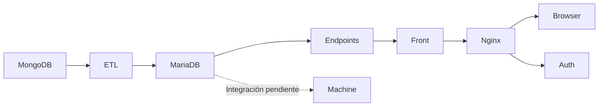

# Artisa Transportes

Sistema de telemetría con datos reales. La entrada web es
[http://localhost:8080](http://localhost:8080), publicada por Nginx.



## Arranque actual

Desde la carpeta del proyecto:

```bash
python3 scripts/start.py
```

El comando prepara `.env` sin reemplazar una autenticación ya configurada y
levanta `mongodb`, `mariadb`, `etl`, `endpoints`, `front`, `auth` y `nginx`.
Espera sus comprobaciones de salud. Machine permanece definido en Compose,
pero no se inicia con este comando. No se importan históricos automáticamente.

Consulta [Configurar el entorno](docs/CONFIGURAR_ENTORNO.md) para instalación,
acceso privado del administrador, sesiones de 12 horas y cambio de contraseña.
No guardes contraseñas, hashes reales ni secretos JWT en Git.

## Componentes actuales

- `ETLs/`: lee MongoDB y escribe `raw_gps` y su estado en MariaDB.
- `DB/schema.sql`: esquema que inicializa el ETL.
- `endpoints/` y `common/`: API independiente y utilidades HTTP/MariaDB.
- `front/`: interfaz y proxy interno hacia endpoints.
- `auth/` y `nginx/`: autenticación JWT y entrada pública protegida.
- `machine_learning/`: trabajador DBSCAN pendiente de integración; sus zonas no
  equivalen a rutas, viajes ni clasificaciones de uso. También guarda los
  entregables del modelo (`generar_mapa.py`, `mapa_operativo.html`,
  `pipeline_machine_learning.html`); el Docker solo usa los `.py`.
- `guias_ml/`: notebook de experimentación (`telemetria_colab.ipynb`) y
  `mapas_telemetria.html`, que lleva sus mapas al navegador con `/api/gps`.
  No forma parte del sistema en producción.
- `scripts/`: arranque, configuración y comprobaciones; recuperación histórica
  explícita y separada del inicio normal.

## Rutas vigentes

Nginx protege `/api/*`. `/` sirve la interfaz; la raíz interna de endpoints
lista sus rutas. `/health` es compacto y público; Machine pendiente no degrada
por sí solo la salud del sistema base.

| Método | Ruta | Estado actual |
| --- | --- | --- |
| POST | `/auth/login` | Autenticación real |
| GET | `/auth/health` | Salud de Auth |
| GET | `/health` | Salud operativa compacta |
| GET | `/api/estado` | Diagnóstico ETL y Machine |
| GET | `/api/faenas` | Catálogo existente |
| GET | `/api/modelo/telemetria` | Estado y zonas DBSCAN existentes |
| GET | `/api/telemetria?limite=30` | Últimos reportes de camiones desde la API de la empresa y estado de conexión; `pending` si no está configurada |
| GET | `/api/telemetria/resumen` | Totales, camiones activos en 24 h y rango; `pending` si no está configurada |
| GET | `/api/mapa` | `PENDING_MACHINE`, sin rutas ni viajes inventados |
| GET | `/api/dashboard` | `pending`, sin métricas calculadas |

El recorrido por vehículo no está implementado y su acción permanece desactivada
mientras Machine está pendiente. El frontend muestra pendientes, no ceros ficticios.
La telemetría actual depende de la futura API de la empresa. No se muestran
los históricos de `raw_gps` como datos actuales. Mientras está pendiente,
`limite` se acepta sin efecto y no se consulta MariaDB para estas dos rutas.

## Comprobar y detener

En Ubuntu/WSL, desde esta carpeta:

```bash
python3 -m unittest discover -s tests -v
python3 scripts/check.py
docker compose ps
docker compose logs --tail 30
docker compose stop
```

En PowerShell antepone `wsl -d Ubuntu --exec` a cada comando.
`scripts/check.py` realiza únicamente GET: comprueba `/`, `/health` y,
si se proporciona `ARTISA_TEST_TOKEN` con un JWT vigente, `/api/estado`.
Sin token informa que la comprobación protegida fue omitida; no valida
completamente el acceso autenticado. No imprime ni guarda el token.
No exige Machine, no modifica datos y no recrea contenedores.

Para proporcionar el token sin escribirlo en el historial de Bash:

```bash
read -r -s -p "JWT vigente: " ARTISA_TEST_TOKEN
printf '\n'
ARTISA_TEST_TOKEN="$ARTISA_TEST_TOKEN" python3 scripts/check.py
unset ARTISA_TEST_TOKEN
```

`tests/check_auth_http.py` usa `ARTISA_TEST_PASSWORD` para pruebas de login.
El comprobador de lectura no utiliza contraseñas ni ejecuta POST de autenticación.
`scripts/check_pipeline.py` queda como referencia provisional del contrato antiguo;
no se ejecuta desde `check.py` y todavía no valida el sistema actual.


Detener o reconstruir los contenedores conserva los datos. No utilices
`docker compose down --volumes` salvo que quieras eliminar la base.

## Configuración local

Nginx es la entrada web en `127.0.0.1:8080` y protege las rutas `/api/`
mediante Auth. El frontend permanece en la red interna de Compose.
Consulta `docs/CONFIGURAR_ENTORNO.md` para el arranque y acceso actuales.

`scripts/prepare_env.py` crea contraseñas aleatorias una sola vez y conserva `.env`
si ya existe. No cambies estas contraseñas mientras uses el volumen actual sin
actualizar también las cuentas de MariaDB. `.env` no entra en Git ni en las imágenes.
La tabla de mensajes y el volumen de la prueba anterior se conservan.

## Catálogo de vehículos (solo camiones)

`raw_gps` conserva todos los vehículos que entregó el GPS; nada se borra. Las
lecturas de camiones (explorador `/api/gps`, Machine, telemetría actual) filtran
con las tablas `vehiculos` y `tipos_vehiculo`, ahora versionadas en `DB/schema.sql`.

- `DB/vehiculos_data.sql` trae el catálogo inicial (124 patentes de patentes.csv).
  El ETL lo aplica al arrancar; solo agrega lo que falta.
- Al arrancar, el ETL registra los vehículos de `raw_gps` que aún no están en el
  catálogo, y tanto el ETL como el servicio `telemetria` registran los nuevos que
  aparezcan. La clasificación automática usa el nombre (`common/vehiculos.py`).
- Una clasificación existente nunca se sobrescribe. Para corregir un vehículo:
  `UPDATE vehiculos SET id_tipo=(SELECT id_tipo FROM tipos_vehiculo WHERE nombre='camion') WHERE asset_id='XXXX00';`
- `/api/estado` muestra cuántos vehículos hay de cada tipo en `catalogo_vehiculos`.

## Telemetría actual (API de la empresa)

El servicio `telemetria` consulta la API SQL de la empresa (`POST {"sql": ...}` →
`{"rows": [...]}`) y guarda los reportes en `telemetria_api`, separada del histórico.
Solo funciona con el equipo conectado a la red de la empresa. Configura en `.env`:

```dotenv
COMPANY_API_URL=http://IP_DE_LA_API:3003/sql
COMPANY_API_TOKEN=          # solo si la API lo pide (se envía en Authorization)
```

y ejecuta `python3 scripts/check_company_api.py` para probar la conexión antes de
levantar el servicio. Sin `COMPANY_API_URL` el servicio queda en espera y la web
muestra "Pendiente de API empresa", igual que antes.

La API ejecuta SQL sobre PostgreSQL. Su tabla `reportes` (~30 M filas) solo tiene
índice por `report_id` (UUID aleatorio) y solo recibe inserciones, así que el conector
avanza por la posición física de cada fila (`ctid`): cada consulta lee solo las páginas
nuevas, en orden de llegada, sin recorrer la tabla ni necesitar índices nuevos. Así
también se capturan los reportes que el GPS envía con atraso. La primera conexión ubica
`COMPANY_API_START` con una búsqueda binaria (~21 consultas de una página).

Comportamiento ante cortes:

- Si se cae el Wi-Fi o la API, reintenta solo (5 s, 10 s, 20 s… máximo 60 s) y
  la web muestra "Reconectando" con los últimos datos recibidos.
- El cursor se guarda junto con cada página: al volver la red recupera todo el
  período desconectado, sin perder ni duplicar reportes (`report_id` es la clave).
- Relee los últimos 5 minutos en cada ciclo para capturar reportes atrasados, e
  ignora fechas más de 10 minutos en el futuro (GPS con reloj adelantado).
- Si cambia la IP de la API, basta con actualizar `COMPANY_API_URL`; el cursor se conserva.
- Si el ciclo se detiene, el contenedor termina y Docker lo reinicia.
- La página Reportes se actualiza cada minuto sin recargar y de inmediato al
  volver la conexión del navegador. Cada fila indica si es una posición reciente
  (menos de 15 min) o el último dato conocido.

`COMPANY_API_TIMEZONE=auto` detecta la hora del origen comparándola con el reloj
de este equipo (mantén la hora del equipo sincronizada).

## Cierre diario (00:00 a 00:00, hora de Chile)

El servicio `machine-diario` (parte de Machine) aplica a cada día las mismas reglas
del cuaderno `guias_ml/telemetria_colab.ipynb` sobre la telemetría en vivo y el
histórico: coordenadas válidas, sin repetidos, une reportes seguidos con pausa de
hasta 5 min y saltos bajo 150 km/h. Un viaje es el recorrido entre dos paradas (10 min
en 200 m); una pausa larga en el mismo lugar (p. ej. cargando con el motor apagado) es
una parada, no corta viajes, y su duración se informa como tiempo detenido.
Guarda un resumen por camión en `reporte_diario`.

- El trabajo pesado (cerrar días, recalcular atrasados y clasificar rutas) corre una vez
  al día a la hora `DIARIO_HORA` (Chile, por defecto 00:30). Para ejecutarlo a mano:
  `docker compose exec machine-diario python -m machine_learning.diario_worker --ahora`.
- Hoy aparece "en curso" y se recalcula cada 10 minutos (`DIARIO_HOY_CADA_MINUTOS`, 0 lo desactiva).
- Pasadas las 00:00 + 15 min, el día se cierra si la API de la empresa respondió
  después de medianoche. Si la API estaba caída, el día queda "esperando datos"
  con cifras provisorias y se cierra cuando vuelva la conexión.
- Si luego llegan reportes atrasados de un día cerrado (revisa los últimos 7 días),
  el día se recalcula solo. Los días se definen como rangos UTC contiguos, así que
  el corte nunca deja reportes fuera ni los cuenta dos veces (incluido el cambio de hora).
- Para incluir días del histórico, define `DIARIO_DESDE=YYYY-MM-DD` en `.env`.

La página Reportes muestra el historial por día (con detalle de cada camión) y el
resumen del mes: `/api/reportes/dia`, `/api/reportes/mes`, `/api/reportes/camion`.
El explorador `/exploracion-gps` ahora también incluye la telemetría en vivo; sus
días siguen siendo días UTC, como antes.

## Clasificación de rutas (Machine)

Corre dentro de `machine-diario`, sin servicios extra:

1. Al calcular cada día se extraen los **viajes entre paradas** de cada camión
   (`machine_learning/viajes.py`): una parada es quedarse 10 min dentro de 200 m.
   Solo se unen reportes seguidos (≤ 5 min, ≤ 150 km/h); los saltos de GPS no se dibujan.
   Los viajes partidos por la medianoche se vuelven a empalmar.
2. Cuando hay días cerrados nuevos (como máximo cada 2 h), `machine_learning/rutas.py`
   toma los viajes de los últimos 90 días (`RUTAS_VENTANA_DIAS`):
   - Asigna origen y destino a una faena (geocerca) o a un lugar frecuente (DBSCAN, 500 m).
   - Agrupa por par origen-destino (ida y vuelta juntas) y por trayectoria (32 puntos,
     distancia media, enlace promedio con umbral de 750 m): un desvío real es otra ruta.
   - La línea de cada ruta es su viaje medoide: un recorrido real, no un promedio.
   - Nivel por cantidad de recorridos: HIGH sobre el percentil 67, LOW hasta el 33.
3. `/api/mapa` y `/api/dashboard` entregan la versión activa; `/api/vehiculos/<id>/recorrido`
   entrega el último día observado de un camión. Sin versión activa siguen en "pendiente".

Para revisar los resultados con los datos reales:

```bash
docker compose exec machine-diario python -m machine_learning.validar_rutas
docker compose exec machine-diario python -m machine_learning.validar_rutas --geojson > rutas.geojson
```

## Pendiente de integración Machine

`common/telemetry_map.py` se conserva como referencia legacy utilizada por sus
pruebas; no está conectado a los endpoints activos.

## Salud del ETL

Endpoints recibe el mismo `TELEMETRY_INTERVAL_SECONDS` que el worker y aplica
su margen de salud: `max(60, intervalo × 3)`. Con 30 segundos, el umbral es 90;
con 300, sería 900. No se confunde con el refresco visual de cinco minutos.

## Archivo histórico del prototipo

Todo lo que sigue se conserva únicamente como documentación histórica.
Las rutas, archivos, variables y procedimientos descritos aquí pueden no existir
en la versión actual. No ejecutar estas instrucciones para operar el sistema.

### Referencia histórica: demostración inicial

Esta sección describe el prototipo anterior; no es el contrato operativo actual.

1. **Origen:** `origen/viajes.csv` contiene 124 filas sintéticas: 120 viajes válidos,
   un duplicado y tres filas inválidas para comprobar la limpieza. Las distancias
   y duraciones son ficticias, aunque las ciudades tienen nombres reales.
2. **ETL:** revisa el archivo cada 15 segundos. Normaliza nombres, espacios y comas
   decimales, valida rangos y rechaza duplicados. La carga se confirma en una
   transacción, con versión SHA-256, conteos y motivos de rechazo.
3. **MariaDB:** conserva viajes, estado de la carga, metadatos del modelo,
   predicciones y solicitudes en el volumen persistente `artisa_mariadb_data`.
4. **Machine Learning:** entrena una regresión lineal con distancia, carga y paradas
   para estimar duración en horas. Evalúa con una división reproducible 80/20,
   reporta el error absoluto medio (MAE) y ajusta el modelo final con todos los
   registros válidos. Guarda una predicción por viaje. Reentrena al cambiar la
   versión del origen o reiniciarse el trabajador.
5. **Endpoints y frontend:** la pantalla consulta datos, estado y predicciones a
   través de la API. El formulario registra una solicitud pendiente en MariaDB;
   Machine la procesa en su siguiente ciclo (cada 2 segundos), guarda el resultado
   y la pantalla lo consulta por ID. Los endpoints no ejecutan el modelo.

El modelo es demostrativo y no está validado para estimar operaciones reales.
El MAE mostrado corresponde a las filas reservadas para evaluación, no al ajuste
sobre todas las filas ni a viajes reales.

### Primer ETL de telemetría real

El mismo contenedor `etl` consulta la API SQL mediante `POST`, lee la lista `rows`,
normaliza las fechas a UTC, valida identificadores y coordenadas y guarda los datos
en `telemetria_raw`. `report_id` es la clave primaria, por lo que repetir una página
actualiza sus datos y no crea duplicados.

La extracción usa paginación por `(report_date, report_id)`, sin `OFFSET`. El cursor
y los conteos se guardan en `telemetria_etl_estado`, dentro de la misma transacción
que la página procesada. La configuración inicial limita la prueba a 5.000 filas de
un solo día para no solicitar accidentalmente los 28,8 millones de registros.

### Entrenamiento geoespacial y mapa operativo

Machine entrena automáticamente un modelo no supervisado DBSCAN sobre hasta 20.000
posiciones válidas de `telemetria_raw`. El modelo agrupa puntos a menos de 0,8 km,
identifica zonas frecuentes y guarda su versión, cobertura y fecha de entrenamiento
en `modelo_telemetria_estado`. Se reentrena cuando cambia el cursor del ETL real.

El mapa usa cartografía OpenStreetMap mediante Leaflet, representa los tramos con líneas sólidas y los divide en tercios: rojo para uso bajo,
naranja para uso medio y verde oscuro para uso alto, las paradas con círculos violetas y la última posición conocida
de cada vehículo con un icono de camión. El frontend consulta la API cada 15 segundos;
cuando el origen entregue datos en tiempo real, los marcadores se actualizarán por el
mismo flujo sin cambiar la interfaz. La cartografía base requiere conexión a Internet.

Configura estas variables únicamente en `.env`:

```dotenv
SOURCE_API_URL=http://HOST_ORIGEN:3003/sql
SOURCE_API_TIMEOUT_SECONDS=90
TELEMETRY_START=2026-03-31T00:00:00
TELEMETRY_END=2026-04-01T00:00:00
TELEMETRY_BATCH_SIZE=500
TELEMETRY_MAX_TOTAL_ROWS=5000
TELEMETRY_INTERVAL_SECONDS=300
TELEMETRY_CATCHUP_INTERVAL_SECONDS=5
TELEMETRY_RETRY_INTERVAL_SECONDS=60
TELEMETRY_CONTINUOUS=0
TELEMETRY_PAGES_PER_CYCLE=1
```

El ETL requiere acceso a la red local del origen. En modo fijo, para ampliar el
histórico cambia la ventana de fechas y reinicia `etl`; el cursor se reinicia pero
los reportes permanecen por `report_id`. Con `TELEMETRY_CONTINUOUS=1`, el fin de la
ventana avanza hasta la hora actual, se conserva el cursor y se buscan datos nuevos
cada `TELEMETRY_INTERVAL_SECONDS`. Cada ciclo procesa como máximo
`TELEMETRY_BATCH_SIZE × TELEMETRY_PAGES_PER_CYCLE` registros. Si todavía hay datos
atrasados, el siguiente bloque comienza después de `TELEMETRY_CATCHUP_INTERVAL_SECONDS`;
al alcanzar el origen, el ETL espera 5 minutos antes de buscar novedades.
Si la red del origen se interrumpe, reintenta despues de
TELEMETRY_RETRY_INTERVAL_SECONDS sin perder el cursor ni duplicar reportes.

### Cambiar el origen

Edita `origen/viajes.csv` y guarda el archivo. No hace falta reconstruir las imágenes;
el ETL lo relee automáticamente. Conserva estas columnas:

```csv
id,origen,destino,distancia_km,carga_kg,paradas,duracion_horas
VIAJE-001,Antofagasta,Calama,220,8000,2,4.5
```

Se necesitan al menos 10 viajes válidos para entrenar el modelo. El ejemplo de una
fila ilustra el formato. Rangos: distancia 1–2000 km, carga 1–40000 kg, paradas
enteras 0–30 y duración observada 0,01–100 horas. Límite del archivo demo: 5 MB.
La duración observada es la variable que el modelo aprende a predecir.

Un CSV sin filas válidas o sin las columnas requeridas se rechaza y se conserva
la carga anterior. Repetir el mismo archivo no duplica viajes. Si se retira un ID
válido del archivo, deja de formar parte de la versión activa; su fila histórica
permanece almacenada. La API muestra solo viajes de la versión activa.

El CSV sigue disponible para probar el modelo sintético. La API real se configura
por separado mediante las variables del primer ETL de telemetría.

### Endpoints

Todos se pueden consultar a través del frontend en `http://localhost:8080`.

| Método | Ruta | Uso |
| --- | --- | --- |
| GET | `/` | Pantalla del proyecto |
| GET | `/health` | Salud del recorrido (503 si hay una etapa sin respuesta reciente) |
| GET | `/api/estado` | Estado, versión del origen, rechazos y metadatos del modelo |
| GET | `/api/resumen` | Totales de viajes, predicciones y destinos |
| GET | `/api/viajes?limite=20` | Viajes de la carga activa con sus predicciones; máximo 500 |
| GET | `/api/telemetria/resumen` | Conteos y rango temporal de la telemetría real |
| GET | `/api/telemetria?limite=30` | Muestra reciente de telemetría real para la página; máximo 200 |
| GET | `/api/telemetria/mapa-calor` | Densidad, tramos, paradas y última posición de cada camión |
| GET | `/api/modelo` | Métricas de evaluación y coeficientes de la regresión simulada |
| GET | `/api/modelo/telemetria` | Métricas y zonas del modelo DBSCAN entrenado con GPS real |
| POST | `/api/predicciones` | Crea una solicitud; responde 202 con ID y URL de consulta |
| GET | `/api/predicciones/{id}` | Estado y resultado persistido de una solicitud |

Cuerpo para solicitar una predicción:

```json
{"distancia_km":180,"carga_kg":8000,"paradas":2}
```
